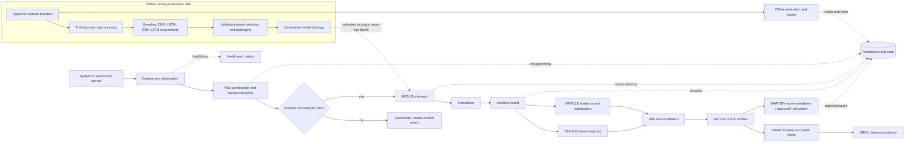
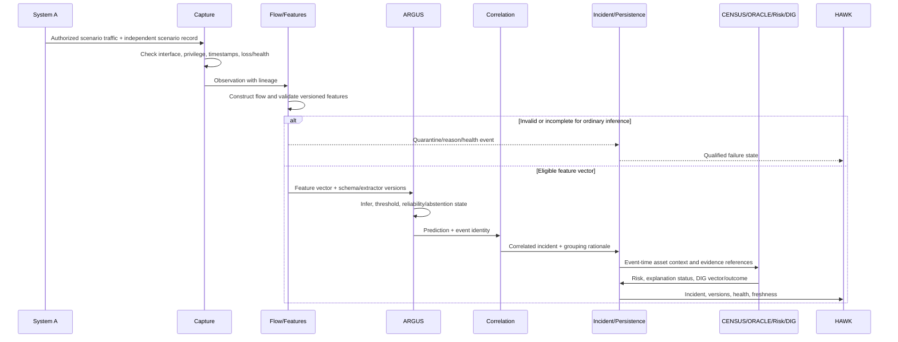

# WallGrid AI — System Design Document

**Project:** Deep Learning Based AI Intrusion Detection and Cyber Defense Platform  
**Status:** Draft for human review; implementation-independent  
**Source of truth:** `docs/PRD.md`, version 0.1, 2026-10-11

> This document describes a proposed logical design. It is not evidence that any component, topology, dataset, model, capture path, performance characteristic, or deployment has been implemented or validated. PRD identifiers are preserved and remain authoritative.

## 1. Purpose and design principles

This document translates the draft project scope into boundaries, responsibilities, data contracts, workflows, failure semantics, and verification obligations. It deliberately does not select a framework, database, capture library, dataset, final model, or production deployment topology. Those choices belong in the later technical design and evaluation plan after the PRD review gates.

Design principles:

1. **Evidence before conclusion.** Every detection, incident, risk assessment, explanation, and simulated action is linked to source observations and versions.
2. **Unknown is not zero.** Missing visibility, asset context, labels, timestamps, evidence, or health information is represented explicitly.
3. **Fail closed for consequential decisions.** Confidence and risk may prioritize review but cannot override failed or unknown integrity, authorization, or response-safety prerequisites.
4. **Offline/live separation.** Training and offline evaluation are reproducible evidence-producing paths; live observation is a separately measured path.
5. **Independent truth.** Scenario labels, analyst dispositions, and response adjudication are not generated from predictions.
6. **Minimal authority.** Capture privileges are isolated from ordinary dashboard/API privileges; the initial release has simulation-only response.
7. **Modular but not over-engineered.** Logical module boundaries and contracts are required; deployment may use one or several processes.
8. **Research honesty.** The comparison of baselines, CNN, LSTM, CNN-LSTM, and DIG policies is a research obligation, not a promise that a particular architecture or policy wins.

Safety boundaries include authorized laboratory traffic only, bounded rates, an operator emergency stop, no public or third-party offensive activity, no unrestricted payload retention, and no real containment or arbitrary command execution. Proposed behavior is not validated behavior; validation requires the PRD evidence described in Sections J, K, L, and O.

## 2. System context and actors

### 2.1 Actors and external dependencies

| Actor/dependency | Responsibilities and trust assumptions |
|---|---|
| Student researcher/model evaluator | Prepares manifests and experiments, inspects failures, compares models/policies, and exports approved evaluation material. Not automatically authorized to approve actions. |
| Lab operator/administrator | Establishes scope, interfaces, topology, permissions, inventory, limits, health checks, and emergency stop. Has operational authority but does not automatically gain analyst approval authority. |
| Lab security analyst | Reviews incidents, examines evidence and assets, annotates/disposes incidents, and approves or rejects simulation requests where authorized. |
| Faculty evaluator | Replays the approved demonstration, inspects provenance and limitations, and evaluates requirement coverage. |
| System A | Authorized traffic source and independently recorded scenario controller/generator. It is not WallGrid ground truth by itself unless its scenario record is independently retained and adjudicated. |
| System B | Monitoring host and, for the provisional MVP topology, host of the relevant service. It runs observation and WallGrid functions subject to privilege separation. |
| Authorized traffic sources | Approved services, replay sources, or controlled scenarios within the written lab scope. No unrestricted destination is in scope. |
| External dependencies | Capture backend/driver, supported interface or virtual mirror, operating system, permitted dataset sources, clock services, local storage, and optional explanation/model tooling. Cloud services, paid APIs, GPUs, and external explanation services are not assumed. |

### 2.2 Boundaries and trust boundaries

The system boundary contains capture readiness, packet/flow lineage, feature extraction, ARGUS, CENSUS, ORACLE, risk, DIG, HAWK, WARDEN, SIBYL, persistence, correlation, authentication/authorization, audit, configuration, health, and evaluation export. System A, the network, imported datasets/model packages, and human-entered notes are outside the trusted application boundary.

Trust boundaries are: (a) network/interface to capture, (b) capture process to ordinary application services, (c) imported dataset/model/evidence to parsers and activation, (d) authenticated user to protected operations, (e) storage/audit to application writers, and (f) dashboard/API clients to rendered content. Network-derived values and analyst text are untrusted content.

WallGrid can observe only packets delivered to an authorized, selected interface or replay source, and only fields permitted by the lab policy. It cannot infer traffic that never reaches the observation path, arbitrary switched traffic from promiscuous mode alone, decrypted payloads without explicit authorization, device identity behind ambiguity/NAT, or causal intent from a model attribution. Lack of an observed packet is not proof that no traffic occurred.

## 3. High-level architecture

### 3.1 Responsibilities and ownership

* **Capture and observation layer** owns interface selection, privilege checks, packet timestamps, capture health, loss indicators, and the observation-source identity. It must not declare an attack.
* **Flow construction and feature extraction** owns the documented flow key, direction convention, expiry/partial-flow policy, feature units/order, schema validation, completeness, and reason codes. It owns feature eligibility, not model decisions.
* **ARGUS detection engine** owns model inference, threshold/score meaning, abstention, model/preprocessor/data versions, and prediction timing. It does not own risk or response permission.
* **CENSUS asset intelligence** owns curated inventory identifiers, endpoint associations, criticality provenance, ambiguity, and event-time snapshots. It never silently converts unknown identity to a known asset.
* **ORACLE investigation and explainability** owns evidence references, bounded summaries, explanation execution/status, and fact-versus-hypothesis labels. Explanations are model-behavior explanations, not causal proof.
* **Risk and confidence engine** owns separate confidence display and versioned risk assessment. It exposes factors, missing context, ranges where needed, and formula versions.
* **DIG** owns four non-compensatory check families, individual outcomes, precedence, aggregate qualification, and response eligibility. It cannot overwrite the underlying prediction.
* **HAWK** owns incident presentation, filters, review lifecycle, statistics, health/freshness states, and analyst actions. It does not invent missing evidence.
* **WARDEN** owns a catalogue of simulation-only recommendations, prerequisites, approvals, expiry, idempotency, and simulation history. No real action connector exists in the initial release.
* **SIBYL** owns descriptive historical aggregates and labelled/unlabelled period distinctions. Forecasting is disabled unless its separate gate passes.
* **Correlation** owns grouping keys/windows and preserves underlying event IDs and grouping reasons. **Persistence** owns durable records, versions, retention, and recovery semantics.
* **Authentication/authorization** owns identity and operation-level permissions. **Audit** owns append-oriented records for both allowed and denied sensitive operations. **Configuration** owns versioned policies, inventory, thresholds, and topology declarations.
* **Health monitoring** owns state transitions for capture, processing, feature extraction, model readiness, storage, correlation, and dashboard freshness. **Evaluation** owns manifests, splits, metrics, timing boundaries, and exports.

### 3.2 Main and offline paths



The live path is observation → eligible flow/features → inference → correlation → incident → context/evidence/risk/DIG → presentation and optional simulation workflow. The offline path produces immutable manifests, experiments, evaluation results, and a package candidate. Live predictions never feed training automatically, and HAWK/ORACLE/WARDEN do not feed ARGUS decisions circularly. A package activation operation is controlled, audited, compatibility-checked, and reversible.

## 4. End-to-end data flows

### A. Offline preparation, training, validation, selection, packaging

1. Record dataset provenance, licence/access status, collection conditions, feature definitions, labels, timestamps, exclusions, and a fingerprint (EVAL-001–002).
2. Define leakage-controlled temporal/host/session/capture-group partitions and preserve a manifest (EVAL-003).
3. Fit preprocessing, imputation, encoding, resampling, calibration, and thresholds only on permitted development data (EVAL-004).
4. Run the trivial reference, classical baseline, CNN, LSTM, and CNN-LSTM under a common protocol and bounded tuning budget; retain failed/infeasible runs and reasons (FR-007, EVAL-005).
5. Select by a predeclared validation rule balancing quality, false alarms, cost, and live compatibility, without opening the final test source (EVAL-006, J.3).
6. Evaluate binary and only supported multiclass tasks using declared units and metrics; report support, undefined metrics, abstention, variability, and resource/latency measures (FR-008–011, EVAL-007–009, 011–013).
7. Package model, preprocessor, feature schema/order/units, label mapping, threshold, calibration metadata, dependency metadata, training-data version, and integrity fingerprint. Reject activation if compatibility or integrity checks fail (FR-010, FR-038, SEC-011).

### B. Live capture through dashboard publication

1. Operator verifies scope, interface, privileges, clock status, active compatible package, and emergency stop.
2. Capture reports ready/denied/wrong-interface/unknown visibility state and emits observation identifiers and timestamps.
3. Flow construction applies the frozen key, direction, expiry, duplicate/late policy, and completeness state (FR-002, FR-005).
4. Feature extraction validates schema, types, units, order, finite/range constraints, missing values, and extractor version. Invalid items are quarantined and not treated as benign.
5. ARGUS infers only eligible features, records score meaning, selected class, threshold, versions, timing, and abstention/reliability state.
6. Correlation groups events under a versioned key/window while preserving source event IDs and grouping rationale (FR-035).
7. Incident creation snapshots event-time asset context, evidence references, risk/confidence assessments, and current qualification state.
8. ORACLE attaches available evidence and an explanation status; missing or pending material remains explicit.
9. DIG evaluates checks and WARDEN may create only catalogue recommendations. HAWK publishes the incident and health/freshness state with all versions.
10. Persistence, audit, metrics, and evaluation records reconcile identifiers and timing. Dashboard disconnection or delayed processing is distinguishable from no incidents.

### C. Asset-aware risk and investigation

CENSUS resolves both endpoints using event-time inventory and records known, unknown, ambiguous, NAT-obscured, or reassigned status. Risk receives declared severity, asset criticality provenance, and independently corroborating evidence. The provisional formula from PRD Section K.3 may be used only as a versioned configurable proposal; unknown factors yield explicit ranges/flags. ORACLE separates measured observations, detector output, analyst annotation, and hypotheses, and each factual assertion links to retained evidence. Confidence, risk, and response permission remain separate.

### D. DIG and response eligibility

DIG records input/pipeline integrity, model reliability/operating conditions, evidence consistency, and response eligibility separately. Proposed precedence is: integrity fail → invalid-input; integrity unknown → needs-review and response-ineligible; reliability/evidence fail or unknown → needs-review and response-ineligible; response fail/unknown → response-ineligible; otherwise accept-for-triage and, if a recommendation exists, eligible-to-request-approval. Not-applicable requires a reason and cannot bypass a required safety prerequisite. This precedence is proposed and linked to DEC-07, FR-020–022, and SEC-008.

### E. Human approval and simulation history

WARDEN binds a catalogue recommendation to incident, target, evidence/policy versions, impact, prerequisites, and expiry. An authenticated authorized analyst approves or rejects the exact proposal. At simulation time, identity, permission, freshness, target, versions, duplicate/idempotency state, and audit availability are rechecked. Any mismatch blocks simulation. The result is labelled **SIMULATION ONLY** and records request, approval/rejection, execution-in-simulator result, failure, and audit links. There is no real-containment state.

### F. Historical analytics and evaluation export

SIBYL aggregates predictions, confirmed dispositions, and missing periods separately over a stated time window and denominator. Drift indicators are not accuracy claims without delayed labels. Approved export includes scenario labels, predictions, policy outcomes, versions, and measurement boundaries after minimization/redaction. Exports, retention, deletion, and access are audited (FR-032–034, FR-040, NFR-012).

### G. Invalid input and recovery

Malformed, unsupported, duplicate, late, partial, or semantically incompatible input is rejected, quarantined, or qualified according to a versioned policy with reason counters. Capture failure produces degraded health, not benign traffic. Model/package failure stops ordinary inference rather than silently reusing an old package. Storage or audit failure blocks sensitive state-changing operations and exposes an audit gap. Overload exposes drops, queue age/depth, and bounded degradation. Recovery reprocesses only under an approved replay/deduplication policy with new provenance; prior audit records are not rewritten.

### Main live-detection sequence



### Response-approval sequence

```mermaid
sequenceDiagram
  participant H as Analyst/HAWK
  participant W as WARDEN
  participant D as DIG/Policy
  participant A as Authorization
  participant S as Simulation
  participant L as Audit/Persistence
  H->>W: Request catalogue recommendation for incident
  W->>D: Evaluate current evidence, prerequisites, safety
  D-->>W: Eligible-to-request or ineligible with reasons
  alt Ineligible or unknown prerequisite
    W->>L: Record denied recommendation and reasons
    W-->>H: No simulation permitted
  else Eligible-to-request
    W-->>H: Exact target, versions, expiry, SIMULATION ONLY
    H->>A: Authenticated approve/reject
    A->>L: Record decision or denial
    H->>W: Submit exact approved request
    W->>D: Recheck current state and approval freshness
    D->>L: Record revalidation
    alt Fresh, bound, authorized, audit available
      W->>S: Run simulation only
      S-->>W: Simulation result/failure; no endpoint change
      W->>L: Record result and links
    else Stale, replayed, changed, or unsafe
      W->>L: Record blocked attempt
      W-->>H: Simulation blocked
    end
  end
```

## 5. Two-system deployment design

### 5.1 Alternatives and provisional recommendation

1. **A generates traffic to a service on B:** B captures its relevant inbound/outbound interface traffic. This is the provisional initial option for a Windows-based prototype because it has the fewest unverified mirroring dependencies, while covering only traffic to/from B.
2. **Isolated VMs with explicit virtual mirroring:** traffic is placed on an isolated virtual network and deliberately mirrored to B. Hypervisor, adapter, driver, and direction support require verification.
3. **Physical mirror/TAP:** a compatible switch mirror or TAP delivers the relevant link to B. This may provide stronger observation but requires suitable hardware, direction/bandwidth verification, and approval.

The recommendation is **proposed**, not approved; it is linked to DEC-02, DEM-001–003, and FR-001. Promiscuous mode alone does not guarantee visibility on a switched network.

### 5.2 Independent visibility proof

Before detector evaluation, the operator records topology, interface names, addresses, direction, driver/backend, privileges, and clock status. A known benign marker and independently counted traffic are generated on A. B verifies capture markers and counts using an observation method independent of ARGUS. Wrong-interface, mirror-disabled, permission-denied, and zero-capture cases must be intentionally distinguished. Only after the expected marker is visible and counts reconcile within the approved measurement method may model evaluation begin. An empty capture is unhealthy/unknown, never successful benign traffic.

Capture runs under the narrowest required Windows privilege and is isolated from ordinary UI/API authority. Interface selection is explicit; timestamps use an unambiguous basis with cross-host offset/uncertainty recorded. Traffic rates, destinations, scenarios, start/end conditions, and emergency stop are bounded under SEC-001 and DEM-008. Encrypted, truncated, fragmented, unidirectional, retransmitted, and unsupported traffic are recorded as declared limitations rather than silently normalized.

## 6. Logical data contracts

These are conceptual records, not database schemas. Required fields must be present for the record’s stated use; optional fields may be absent; unknown means not established; invalid means rejected or quarantined and not eligible for ordinary detection.

| Record | Essential fields and semantics |
|---|---|
| Observation / packet / flow lineage | Observation ID, source/interface ID, packet/flow ID, endpoints/protocol, direction state, first/last event time, processing time, counters, closure reason, completeness, loss/quality state, parent references, extractor/schema version. Missing required lineage is invalid for ordinary detection. |
| Feature vector | Flow/window ID, ordered feature names, values, types, units, missing-value states, direction/sequence metadata, schema and extractor version, eligibility and reason. Non-finite, wrong-unit, missing-required, or incompatible data is invalid. |
| Prediction | Prediction ID, input ID, class/output, score and score meaning, threshold, calibration state, model/preprocessor/data versions, inference timestamps, reliability/abstention state, failure reason if applicable. A score is not called a probability without evaluation. |
| Incident | Incident ID, underlying event/prediction IDs, correlation rule/version/reason, time bounds, classification/qualification, endpoint references, asset snapshot ID, risk assessment IDs, evidence/explanation state, review lifecycle, disposition and actor/time history. |
| Asset context | Stable inventory ID if known, observed identifiers, role/owner/context if supplied, criticality, provenance, resolution state, last-update time, event-time snapshot/version, ambiguity/NAT/reassignment flags. |
| Risk assessment | Assessment ID, incident ID, formula/version, severity/asset/evidence factors, weights/bands, missing-factor flags/range, score, confidence reference, assessor/service, time, supersedes link. It is not probability or permission. |
| DIG assessment | Assessment ID, incident/prediction/recommendation links, four check results (pass/fail/unknown/not-applicable), reasons/evidence, policy version, aggregate outcome, evaluation time, software/policy versions. |
| Evidence / explanation | Evidence ID, source record IDs, type, provenance, integrity/reference, availability, collection/observation time, explanation method/model/reference-data versions, status, limitation, fact/hypothesis classification. |
| Recommendation / approval / simulation | Recommendation ID, catalogue entry, incident/target, intended effect/impact, prerequisites, evidence/policy versions, expiry, actor/authorization, approval/rejection, idempotency key, revalidation result, simulation result, no-real-action assertion, audit links. |
| Audit record | Audit ID, actor/service, authenticated operation, target/entity IDs, time, outcome, reason, relevant versions, denial/failure details, integrity/tamper-evidence metadata, no secrets. Audit-write failure is itself observable. |
| Health status | Component, state (healthy/degraded/failed/unknown/stale), observed time, transition reason, dependency/version, queue/drop/error counters, recovery marker, scope of affected records. Unknown is not zero. |
| Evaluation result | Experiment/scenario ID, manifest/fingerprint, split, seed, model/policy versions, unit/denominator, metrics, support, latency/resource boundaries, drops, uncertainty, status, limitations, reviewer/evidence reference. |

All identifiers are stable within the evaluation scope and linked, not copied as ambiguous text. Event time, processing time, publication time, and display time are distinct; storage uses an unambiguous time basis and display timezone is explicit. Clock offset and uncertainty are retained for cross-host latency. Corrections create new versions or superseding records; they do not rewrite prior audit history.

## 7. Model and feature lifecycle

Training and live pipelines must share a versioned semantic contract: identical feature names/order, types, units, direction semantics, missing-value rules, transformations, flow/window definitions, and schema version (FR-003, DEM-005). If a dataset feature cannot be reconstructed with the same meaning live, it is removed consistently, reconstructed with validated semantics, or triggers retraining/scope change; convenient constants are not an approved compatibility strategy.

Flow direction, sequence axes, ordering, padding/masking, overlap, warm-up, partial flows, and active-window behavior are explicit. Tabular columns do not inherently have spatial meaning for CNNs, and dataset row order is not automatically time for LSTMs. A complete-flow model cannot silently be treated as valid for partial windows. Long-lived flows require a validated active-window policy or a disclosed delay.

Packages bind preprocessing, schema, labels, thresholds, calibration (if supported), dependencies, training-data manifest, and fingerprints. Activation checks compatibility and integrity, records readiness, and supports rollback to a previously compatible package. Failure to load stops ordinary inference and exposes degraded health; it does not silently reuse an incompatible artifact. Activation is authorized, versioned, and audited.

The experiment matrix must include a trivial reference, classical baseline, CNN, LSTM, and CNN-LSTM under the same approved splits, metrics, and proposed `P_common` population (FR-007, EVAL-005). No final architecture, dataset, framework, feature layout, or temporal representation is selected here. The technical design and evaluation plan must resolve DEC-03, DEC-04, DEC-13, DEC-14 and TGT-01–07.

### 7.1 Common model-comparison population and final-source boundary

For direct architecture comparison, every feasible arm consumes the same proposed **`P_common`** prediction-anchor population. One anchor is one approved flow or event-time window; packet, flow/window, incident, scenario, and response denominators are never mixed. The common manifest records stable or pseudonymous anchor reference, split/group, independent label state, feature eligibility, sequence eligibility, warm-up, padding/mask state, exclusions, and denominator effect.

An anchor is eligible only when its required live-compatible fields and independent label/truth state are available, it is not invalid/quarantined/duplicated, it is outside no prohibited group or time boundary, and it contains no future/post-incident information. LSTM/CNN-LSTM use ordered context for the same anchor; warm-up observations are not scored, insufficient context is `sequence_ineligible`, and padding/masking cannot introduce labels or future information. Missing required fields are invalid unless the frozen schema explicitly permits `unknown`. Related flows/windows, duplicates, augmented derivatives, shared markers, and dependent capture artifacts are purged before splits and `P_common` construction. Invalid-input rejection, sequence ineligibility, unsupported labels, timeout, and broader arm-specific operational coverage are reported separately rather than changing the direct-comparison denominator.

This is a proposed, dataset-agnostic contract. The data-specific anchor, label map, common-population support, sequence applicability, and exact split remain DEC-03/DEC-04/DEC-14 decisions. No model result or architecture winner is implied.

Final-source access uses the classes in PRD J.3.1: public metadata/provenance and source-level integrity/independence checks may support M1; record-level development data must be explicitly designated and cannot later be treated as untouched final evidence; final labels, features, records, scores, row-derived statistics, and results remain sealed until `IMP-089` and final-test authorization. The access ledger records attempted and successful access, source designation, actor, purpose, authorization, fields/operations, fingerprints, and reviewer.

## 8. DIG, risk, and decision boundaries

The four DIG families are:

* **Input/pipeline integrity:** schema, finite/range checks, completeness, fingerprints, capture health, and extractor/model compatibility.
* **Model reliability/operating conditions:** validated envelope, score interpretation/calibration, uncertainty, shift indicators, and sequence warm-up.
* **Evidence consistency:** independent protocol/counter/timing/rule evidence and contradictions; model attribution alone is not independent corroboration.
* **Response eligibility:** approved target, evidence sufficiency, impact/scope, identity/permissions, policy freshness, and simulation-only constraints.

Each check is pass/fail/unknown/not-applicable with reason, evidence reference, policy version, and time. Fail or unknown in a required integrity or safety prerequisite blocks response eligibility. A high score cannot override it. Detection can remain visible as qualified, and risk can prioritize review, but neither is authorization.

Keep four quantities distinct: **detection confidence** describes a model score under its declared meaning; **incident risk** is a provisional, configurable prioritization assessment; **analyst disposition** is a human evidence-based review record; **response permission** is a policy/authorization result. The proposed Section K.3 formula is not a probability and remains subject to DEC-06 approval, boundary tests, missing-context treatment, and versioning.

The functional requirement is to implement and record the checks (FR-020–022, FR-023–024). The research hypothesis H-DIG-01 asks whether B0 fixed threshold, B1 confidence-gated, B2 context-aware risk, and B3 proposed DIG change unjustified eligibility, review burden, coverage, delay, or resource use. This design does not claim DIG novelty, effectiveness, or superiority. All arms retain non-negotiable parser, authorization, and simulation-only safeguards.

## 9. Security, privacy, and safety architecture

Protected operations use authenticated identities and operation-level role authorization for viewer, analyst, administrator, and evaluator. Configuration, inventory, model activation, policy changes, exports, approvals, and simulation are explicitly permissioned. Capture elevation is isolated from the dashboard/API. Sessions, revocation, cross-role denial, and unauthenticated requests are test obligations (SEC-002–004).

All packets, imports, API fields, model metadata, analyst notes, and explanation inputs are untrusted and size/resource-limited. Embedded commands and executable deserialization are prohibited. Secrets are never committed, displayed in errors, or exported. Collection is minimized; payload capture is disabled unless separately authorized. Rendered network fields and notes are inert text.

Evidence, policies, approvals, and provenance are access-controlled. Ordinary users cannot rewrite audit records; the chosen tamper-detection method and its trust boundary remain a technical-design decision. Audit includes denied operations and attempted responses. If audit writing fails, approval, simulation, and sensitive configuration changes fail closed; detection may continue only with an explicit audit-gap health state.

Approval is revalidated at simulation time against identity, target, current evidence freshness, policy version, authorization, and idempotency. Replayed, stale, duplicate, or changed-target requests are blocked. Simulations cannot modify endpoints, firewalls, hosts, or execute arbitrary commands. Real disruptive response is prohibited in the initial release (FR-029–031, SEC-008–010).

### 9.1 Proposed security, privacy, and operational contracts

These are proposed logical contracts for the implementation plan; none is implemented or verified.

- **Authentication/session/RBAC:** Each protected request carries an authenticated subject, session state, operation, target, and server-side permission decision. Issuance, expiry, revocation, logout, and failure are explicit states. Protected mutations fail before business-state change when identity, session, role, ownership, or concurrency checks fail. Capture identity is not a dashboard administrator, model promoter, audit deleter, approver, or simulator by default.
- **Capture isolation and stop:** Capture uses the narrowest OS identity/process boundary and an allowlisted, bounded IPC channel. An independently operable lab stop blocks new capture/traffic and records the transition even if the dashboard or capture process is unavailable. The capture path does not inherit dashboard/API authority.
- **Durability/loss:** Every handoff declares persistence-before-acknowledgement/publication, checkpoint, retry, deduplication key, replay policy, and failure state. Persisted, lost, rejected, replayed, duplicated, and unavailable records remain distinguishable; no exactly-once claim is assumed.
- **Audit integrity:** Audit is append-oriented and access-controlled, links actors/services, entity/version IDs, event and monotonic timing, and uses a proposed tamper-evidence mechanism with an explicit trust boundary. Alteration, deletion, reordering, truncation, and clock anomalies are detected or marked unknown. Approval, simulation, and sensitive configuration changes fail closed if required audit evidence cannot be committed.
- **Privacy and retention:** Every field is classified as prohibited, transient, diagnostic, persisted, or exportable. Payload capture is disabled by default. Pseudonymization uses a documented stable namespace with mapping material separated from exports. Retention, deletion, backup, and retained-audit-metadata behavior disclose limits rather than promise universal erasure.
- **API contract:** Each operation has a versioned request/response schema, permission, bounded input/output, safe error code/detail, correlation ID, ownership/concurrency rule, and idempotency/retry behavior. Invalid requests do not mutate business state and errors do not expose secrets or executable content.
- **Simulation boundary:** WARDEN consumes only a closed catalogue entry bound to the incident, target, policy/evidence versions, approval, and expiry. Independent process/network/endpoint observations are required to support the no-effect claim; `simulation_only` and `endpoint_changed` fields are not proof by themselves.

The implementation plan assigns these contracts to `IMP-076`–`IMP-088` and requires them before their downstream consumers. The contracts remain subject to DEC-06–DEC-10, ADR-02/05/06, and M0/M1 review.

## 10. Operational health and performance

Health is independently observable for capture readiness/visibility, flow processing, feature extraction, model readiness, persistence, correlation, audit, and dashboard freshness. States distinguish no traffic, no attacks, sensor failure, capture loss, model unavailable, pending explanation, stale UI, storage failure, and overload (NFR-011).

Measurements must declare boundaries and units. Record offered/captured/processed packets and flows, eligible predictions, incidents, drops/rejections, queue depth/age, CPU/RAM/storage and applicable GPU resources. Measure idle, nominal, and overload conditions on a named approved Windows profile.

Inference latency is the monotonic interval around prediction computation with preprocessing/batching/warm-up inclusion stated. Feature-ready-to-visible latency includes queueing, inference, policy, persistence, transport, and publication. Observable-onset-to-visible latency additionally includes flow/window waiting. These are not interchangeable, and neither is called real-time without evidence. Numeric budgets and capacity/resource/retention/workload/study adequacy remain TGT-01–07 and require approval; no values are invented here.

## 11. Failure modes and recovery

| Failure condition | Detection mechanism | Safe behavior | User-visible state | Audit/evidence behavior | Recovery expectation | PRD links |
|---|---|---|---|---|---|---|
| Capture permission denied | Startup privilege check/capture error | Stop capture; never report benign zero traffic | Capture unhealthy/permission denied | Error, interface, actor/time recorded | Operator corrects privilege and reruns visibility proof | FR-001, SEC-002, DEM-002–003 |
| Wrong interface | Configured interface vs known marker/count mismatch | No detector evaluation | Wrong-interface/visibility unknown | Marker and selected-interface evidence retained | Re-select and repeat independent proof | FR-001, DEM-002 |
| Invisible traffic/mirror disabled | Independent capture markers absent | Block acceptance and normal conclusion | No visibility, not no attacks | Expected/observed counts and topology recorded | Repair path/mirror and revalidate | DEM-001–003 |
| Malformed features/schema mismatch | Contract, finite, type/unit/version checks | Quarantine; no ordinary inference | Invalid input with reason | Invalid item, reason/counter, lineage retained | Repair/replay only under new provenance | FR-003–006, SEC-005 |
| Incompatible model package | Manifest/schema/dependency/fingerprint check | Do not activate; stop ordinary inference | Model unavailable/degraded | Activation attempt and mismatch audited | Roll back compatible package or repair | FR-010, FR-038, SEC-011 |
| Missing/ambiguous asset context | CENSUS resolution/provenance check | Preserve unknown; use approved provisional range/policy | Asset unknown/ambiguous | Snapshot and resolution reason retained | Curate inventory; new assessment version | FR-013–015, FR-023 |
| DIG failure or unknown | Check exception/missing prerequisite | Needs review; response-ineligible | Qualified incident and failed/unknown checks | Full vector and policy version retained | Repair evidence and create new assessment | FR-020–022, SEC-008 |
| Storage failure | Write errors/health probe/queue growth | Block sensitive changes; bound queues | Persistence degraded/storage failure | Write failure and affected IDs retained where possible | Restore storage; reconcile lost/persisted events | NFR-005, SEC-010, FR-036 |
| Audit-write failure | Audit append error/integrity check | Block approval, simulation, config changes | Audit gap; action unavailable | Failed audit attempt exposed; no silent success | Restore audit path and retry as new operation | SEC-007, SEC-010 |
| Dashboard disconnection/stale UI | Publication heartbeat/version/freshness | Continue qualified processing; never imply current view | Disconnected/stale dashboard | Publication timing and missed updates recorded | Reconnect and reconcile from persistence | FR-027, NFR-011, DEM-009 |
| Stale/replayed approval | Freshness, target/version/idempotency recheck | Block simulation | Approval expired/replayed | Denied attempt and binding details audited | Obtain new approval after re-evaluation | FR-030–031, SEC-009 |
| Overload/backlog | Queue age/depth, drops, resource sampling | Bounded degradation, explicit rejects/abstention; no silent loss | Overloaded/degraded | Counts, timings, affected scope recorded | Reduce load/restart/recover under approved policy | FR-006, NFR-002–005, TGT-03–04 |

## 12. Architecture decisions and unresolved questions

The following register does not replace PRD decision IDs. Every entry is provisional unless explicitly approved later.

| ADR | Topic | Proposed default | Alternatives | Rationale / risks and tradeoffs | Evidence required | Owner / PRD link | Status |
|---|---|---|---|---|---|---|---|
| ADR-01 | Capture topology | A-to-B service traffic on Windows | VM mirror; physical mirror/TAP | Lowest dependency MVP; limited coverage and resource contention | Independent visibility proof, driver/privilege test | Lab operator / DEC-02, DEM-001–003 | Proposed |
| ADR-02 | Process boundaries | Logical modules with few bounded processes | Single process; many services | Preserves contracts without unnecessary infrastructure; process failure/recovery boundaries TBD | Failure injection and resource measurements | Technical lead / NFR-008 | Unresolved |
| ADR-03 | Flow semantics | Bidirectional transport flow with normalized endpoints and explicit unknown direction | Unidirectional flows; packet/windows | Supports endpoint context but depends on direction/timeout validation | Deterministic fixtures and live parity | Technical/research lead / DEC-04, DEM-004 | Proposed |
| ADR-04 | Model/data interface | Versioned package binding schema, preprocessor, labels, thresholds, and provenance | Separate independently managed artifacts | Binding prevents semantic mismatch; reduces swap flexibility | Incompatible-package and rollback fixtures | Research lead / FR-003, FR-010, FR-038 | Proposed |
| ADR-05 | Persistence boundaries | Durable lineage, incidents, versions, audit, and evaluation records separated conceptually | Single store; transient event-only design | Enables reconciliation and audit; retention/storage complexity remains | Outage, deletion, recovery, and audit-gap tests | Technical lead / FR-036, FR-040, NFR-012 | Unresolved |
| ADR-06 | Event transport | Bounded, versioned handoff with explicit queue/drop semantics | Direct calls; unbounded broker | Student-feasible while exposing overload; exact mechanism is TBD | Load, duplicate, late, and restart tests | Technical lead / FR-005–006, NFR-003 | Unresolved |
| ADR-07 | Explanation execution | Asynchronous, bounded explanation path that never blocks primary detection | Synchronous explanation; deterministic only | Protects detection latency; pending/failed states must be visible | Explanation latency/failure and NFR-014 measurements | Research lead / DEC-08, FR-017 | Proposed |
| ADR-08 | Deployment configuration | Explicit versioned local configuration with authorized changes | Environment-only or hard-coded settings | Supports reproducibility and audit; secret handling and UI still TBD | Config authorization, rollback, and export tests | Lab operator / DEC-09, FR-037 | Unresolved |
| ADR-09 | Risk and DIG policy | Non-compensatory check vector and provisional configurable risk formula | Alternative formula/precedence | Matches safety boundary without claiming effectiveness | Boundary, missing-data, B0–B3 and ablation evidence | Supervisor/analyst / DEC-06–07, FR-020–024 | Proposed |

Unresolved decisions include Windows/hardware/driver/VM availability, dataset and label mapping, Access Class D source/direction, flow and sequence semantics, `P_common` instantiation, TGT-01–07, independent dataset availability, operating-point/comparison rules, risk rubric, observable DIG checks, explanation method, asset/retention policy, simulation catalogue, history sufficiency, and project capacity. These are DEC-01–14 and must be resolved at the PRD gates before implementation.

## 13. Traceability

### 13.1 Component and flow coverage

| Design area | Inputs | Outputs | Dependencies | Failure behavior | Verification obligations |
|---|---|---|---|---|---|
| Capture/observation | Authorized interface, scope, packets | Observations, health, loss, timestamps | Windows driver/backend, privileges, topology | Unhealthy/unknown, no benign conclusion | FR-001, FR-006, DEM-001–003, AC-01 |
| Flow/features | Observations, contract/config | Flows, feature vectors, lineage | Flow decision, schema/package contract | Quarantine/reject/qualify | FR-002–006, DEM-004–005, AC-01 |
| ARGUS/offline lifecycle | Eligible vectors; manifests | Predictions, package, evaluation records | Preprocessor, model, split, package | Abstain or unavailable; no silent reuse | FR-007–012, FR-038–039, EVAL-001–013, AC-02 |
| CENSUS/risk | Endpoints, inventory, evidence factors | Asset snapshot, risk assessment | Curated inventory, approved rubric | Unknown/ambiguous and range/flag | FR-013–015, FR-023–024, AC-03, AC-06 |
| ORACLE | Incident, evidence, model metadata | Provenance summary, explanation status | Evidence store, selected method | Pending/failed/unavailable, no invented facts | FR-016–019, AC-04 |
| DIG | Prediction, health, evidence, policy, recommendation | Check vector and aggregate outcome | Policy/config, authorization | Fail closed for response | FR-020–022, SEC-008–010, EVAL-010, AC-05 |
| Correlation/incidents | Predictions/events | Incidents and grouping rationale | Versioned keys/windows, persistence | Preserve originals; duplicate-safe | FR-035–036, AC-07, AC-10 |
| HAWK | Incidents, health, history | Views, filters, review/dispositions | Auth, persistence, publication | Stale/disconnected state visible | FR-025–028, NFR-009–011, AC-07 |
| WARDEN | Qualified incident, DIG, catalogue, approval | Recommendation and simulation history | Auth, audit, simulator | Ineligible/stale/replayed blocked | FR-029–031, SEC-008–010, AC-08 |
| SIBYL/export | Historical records, labels, versions | Trends, health analytics, redacted export | Retention, time windows, auth | Missing periods distinct from zero | FR-032–034, FR-040, AC-09–AC-10 |
| Cross-cutting security/operations | All protected operations and failures | Auth decisions, audit, metrics, recovery records | Storage, config, clock | Explicit degraded state and bounded recovery | FR-036–040, NFR-003–008, 011–013, SEC-001–012, AC-10 |

### 13.2 Requirement and acceptance mapping

The architecture directly covers objectives **OBJ-01–OBJ-07**, use cases **UC-01–UC-07**, functional families **FR-001–FR-040**, non-functional requirements **NFR-001–NFR-014**, security requirements **SEC-001–SEC-012**, and deployment requirements **DEM-001–DEM-009**. Model/data evaluation obligations are **EVAL-001–EVAL-013**; acceptance obligations are **AC-01–AC-11**. The future verification chain remains objective/use case → requirement → design contract/decision → test or experiment → evidence → acceptance (PRD O.1).

| Major flow | PRD traceability |
|---|---|
| Offline model/data lifecycle | OBJ-02, FR-007–012, FR-038–039, EVAL-001–013, NFR-001–006, AC-02 |
| Live visibility and detection | OBJ-01, OBJ-06, FR-001–011, NFR-002–005, 007, 011, DEM-001–007, AC-01–02, AC-11 |
| Asset-aware investigation | OBJ-04, FR-013–019, FR-023–024, NFR-009, AC-03–04, AC-06 |
| DIG/risk/decision safety | OBJ-03, OBJ-05, FR-020–024, EVAL-010, EVAL-012, SEC-008–010, AC-05–06 |
| Dashboard/history | FR-025–028, FR-032–035, NFR-009–014, AC-07, AC-09 |
| Simulation-only response | OBJ-07, FR-029–031, SEC-001–012 as applicable, DEM-006, DEM-008–009, AC-08 |
| Integrated and evaluation evidence | OBJ-01–OBJ-07, DEM-001–DEM-009, EVAL-001–EVAL-013, AC-01–AC-11, TGT-01–TGT-07 |

These are traceability links, not claims of completion. Each individual PRD identifier requires a future evidence row and positive/negative or applicable boundary test before acceptance.

## 14. Proposed milestone crosswalk, limitations, and design review checklist

### 14.1 Common milestone meanings

The PRD §N table is the canonical proposed crosswalk. This document uses the same names and evidence boundaries; it does not create a second milestone scheme.

| Milestone | Meaning | Prerequisite → deliverable boundary | Acceptance/stop |
|---|---|---|---|
| M0 — Governance and documentation approval | Authority, roles, scope, safety, document precedence, and next activity | Human review of the seven documents → approval/decision/blocker record | No implementation or experiment authorization without attributable approval. |
| M1 — Feasibility, data, semantics, and evaluation protocol | Visibility, lawful data/labels, live semantics, `P_common`, leakage, access classes, targets | M0 → feasibility, data/contract, split, target, and access-ledger records | No final record/outcome access, model commitment, or live claim when a boundary is unresolved. |
| M2 — Reproducible development experiments and package | Matched model comparison and validation-only package | M1 → experiment ledger, failed runs, selected package/inference contract | Final source remains sealed; unsupported arms remain explicitly limited. |
| M3 — Integrated observation and investigation conformance | Live/offline parity through incident investigation | M2 plus foundation contracts → capture/flow/context/evidence/dashboard conformance | Invalid/missing evidence or confidence/risk/permission conflation stops the gate. |
| M4 — DIG and simulation-only response conformance | Four checks, WARDEN catalogue, approval, revalidation, no-effect boundary | M3 plus policy contracts → DIG/WARDEN safety evidence | No real action, unsafe eligibility, or missing audit. No effectiveness claim. |
| M5 — Historical, operational, and policy study | History, performance/recovery, B0–B3, ablations, injections, integrated evidence | M3/M4 plus approved targets/privacy → operational/policy evidence | Unknown boundaries, silent loss, circular truth, or unfair comparison blocks. |
| M6 — Final sealed evaluation, reproducibility, and human acceptance | Freeze, sealed evaluation, rerun, traceability, limitations, human disposition | M5 → `IMP-089`, sealed run, exact rerun, acceptance record | Final access follows freeze; unmet requirements remain visible. |

### 14.2 Known limitations and assumptions

This design assumes that two isolated execution environments, capture permissions, a usable supervised dataset, bounded authorized scenarios, independent scenario records, and designated reviewers can be obtained; each remains unconfirmed. Visibility may be limited to traffic delivered to B. Encrypted, partial, truncated, or ambiguous traffic can reduce evidence and feature parity. Offline quality does not establish live quality, generalization, production readiness, or hard real-time behavior. A suitable independent second dataset may not exist; the fallback in EVAL-013 is not equivalent cross-dataset validation. DIG may add delay, abstention, workload, or no benefit. Forecasting, anomaly detection, ATT&CK mapping, multiclass breadth, alternative topologies, and external explanation services remain conditional or optional.

No hardware specification, numeric target, framework, final dataset, model winner, explanation method, risk weight, retention period, or topology is approved here. No component, test, dataset, deployment, performance result, or safety claim is implemented or validated by this document.

### 14.3 Design review checklist

- [ ] All PRD identifiers and status meanings are preserved; no design proposal is presented as implemented evidence.
- [ ] Every component has an owner, input/output boundary, version contract, failure state, and linked PRD coverage.
- [ ] Main live path and offline training/evaluation path are distinct and acyclic.
- [ ] Packet, flow, feature, prediction, incident, asset, risk, DIG, evidence, action, audit, health, and evaluation lineage is reconstructable.
- [ ] Required/optional/unknown/invalid semantics and timestamp boundaries are explicit.
- [ ] Windows capture privileges, interface choice, topology, mirror direction, timestamps, limits, and emergency stop are independently verifiable.
- [ ] Empty capture is not treated as benign traffic; visibility is proven before detector evaluation.
- [ ] Training/live feature compatibility, flow direction, partial windows, sequence semantics, and CNN/LSTM representation assumptions are approved.
- [ ] The matched `P_common` population, sequence warm-up/padding/masking, missing-feature, overlap-purge, exclusion, and broader-coverage rules are approved.
- [ ] Baseline, CNN, LSTM, CNN-LSTM, leakage control, untouched final test, cross-dataset condition, and failed-run reporting are covered.
- [ ] Final-source access classes/ledger and pre-access `IMP-089` freeze are explicit; public metadata is not treated as final record access.
- [ ] Confidence, risk, analyst disposition, and response permission are separate; provisional risk formula is labelled.
- [ ] DIG contains four check families, preserves individual results, fails closed, and does not claim effectiveness.
- [ ] Authentication, authorization, secret handling, untrusted input, capture privilege separation, minimization, audit failure, stale approval, replay prevention, and simulation-only restrictions are reviewed.
- [ ] Failure paths cover capture, visibility, malformed data, package incompatibility, asset gaps, DIG unknown, storage/audit, dashboard staleness, approval freshness, and overload.
- [ ] Health states distinguish no traffic, no attacks, sensor/model/storage failure, pending explanation, stale UI, and dropped/backlogged data.
- [ ] TGT-01–07 and DEC-01–14 have owners and approval gates; unresolved technical choices are not silently finalized.
- [ ] Acceptance and demonstration evidence map to AC-01–AC-11 and DEM-001–DEM-009.
- [ ] Human review confirms that the document remains a draft before any implementation or test activity begins.

**Document state:** Draft; await supervisor/project-owner review and PRD approval. `docs/TECHNICAL_DESIGN.md` exists as a proposed companion document; its existence is not approval. Historical drafting references to it as absent are superseded by this statement.
